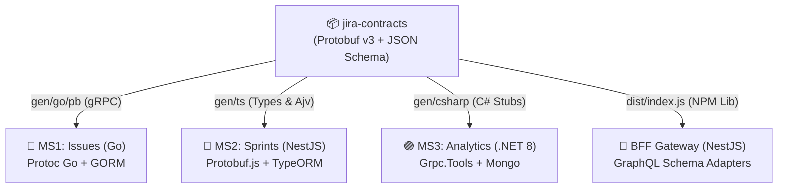

# 📦 Jira Contracts (`jira-contracts`)

[]()
[]()
[]()
[]()

Repositorio central y fuente única de la verdad (**Single Source of Truth**) para todos los contratos de comunicación inter-servicio de la plataforma **Jira AI**. Define las especificaciones de interfaz canónicas para **gRPC (Protobuf v3)** y los esquemas de eventos de **Apache Kafka (JSON Schema)**, junto con pipelines automáticos de generación de código fuertemente tipado para **Go**, **TypeScript** y **C# (.NET 8)**.

---

## 🏛️ Rol en la Arquitectura Global

En una arquitectura políglota distribuida, los contratos compartidos desacoplan a los equipos de desarrollo y garantizan el cumplimiento estricto de la **Regla de Interoperabilidad**:



---

## 📋 Contratos y Esquemas Incluidos

### 1. Protocol Buffers v3 (`protos/`)
* **`protos/issues.proto`** (`package jira.issues.v1`):
  * Define las entidades de dominio `Issue`, `Project`, `UserReference` y enumeradores `IssueStatus`, `IssuePriority`, `IssueType`.
  * Define los servicios RPC: `CreateIssue`, `GetIssue`, `ListIssues`, `UpdateIssueStatus`, `BatchAssignToSprint`.
* **`protos/sprints.proto`** (`package jira.sprints.v1`):
  * Define las entidades `Sprint`, `SprintStatus`, y RPCs de ciclo de vida: `CreateSprint`, `GetSprint`, `StartSprint`, `CompleteSprint`, `PlanSprint`.
  * Define `AlertService` (`TriggerSprintAlert`) consumido por .NET para notificaciones de riesgo.

### 2. Esquemas de Eventos Kafka (`schemas/`)
* **`schemas/issues.events.json`**: Esquema de eventos de dominio emitidos por MS1 en el tópico `issues.events` (`CREATED`, `UPDATED`, `STATUS_CHANGED`, `DELETED`).
* **`schemas/analytics.query.json`**: Esquema de solicitud para el patrón **Kafka Request-Reply** sobre el tópico `analytics.query`.
* **`schemas/analytics.reply.json`**: Esquema de respuesta emitido por MS3 en `analytics.reply` conteniendo métricas de velocidad, burndown y alertas.

---

## 📂 Estructura del Repositorio

```text
jira-contracts/
├── .github/workflows/
│   └── ci.yml               # Pipeline de validación de esquemas y tests
├── gen/                     # Stubs generados
│   ├── go/                  # Paquetes compilados de Go
│   ├── ts/                  # Definiciones TypeScript .d.ts
│   └── csharp/              # Clases C# generadas
├── protos/
│   ├── issues.proto         # Contrato canónico de Issues
│   └── sprints.proto        # Contrato canónico de Sprints
├── schemas/
│   ├── issues.events.json   # Eventos de dominio Kafka
│   ├── analytics.query.json # Request Kafka Request-Reply
│   └── analytics.reply.json # Reply Kafka Request-Reply
├── scripts/
│   ├── generate-go.sh       # Compilador protoc-gen-go
│   ├── generate-ts.sh       # Compilador ts-proto
│   └── generate-csharp.sh   # Compilador protoc csharp
├── src/
│   ├── index.ts             # Exportaciones principales del paquete
│   └── validator.ts         # Validador de esquemas Kafka con Ajv
├── tests/
│   ├── index.spec.ts
│   ├── schemas.spec.ts      # Validación formal de esquemas JSON
│   └── validator.spec.ts    # Pruebas del validador Ajv en tiempo de ejecución
├── package.json
└── tsconfig.json
```

---

## 🧪 Pruebas Automatizadas y Cobertura

El repositorio cuenta con una suite exhaustiva de validación con **Ajv (Another JSON Schema Validator)** y Jest:

```bash
# Instalar dependencias
npm install

# Compilar contratos TypeScript
npm run build

# Ejecutar suite de pruebas unitarias y validación formal de esquemas
npm test
```

### Métricas de Cobertura
* **Statements:** 100%
* **Branches:** 100%
* **Functions:** 100%
* **Lines:** 100%
* **Total de Pruebas:** 174 pruebas unitarias pasando con éxito.

---

## 🚀 Integración en Microservicios

### En Go (`jira-issues-go`):
```go
import pb "jira/contracts/issues"

func (s *server) GetIssue(ctx context.Context, req *pb.GetIssueRequest) (*pb.IssueResponse, error) {
    // Implementación tipada con Protobuf Go
}
```

### En TypeScript / NestJS (`jira-sprints-nestjs`, `jira-bff`):
```typescript
import { IssueStatus, validateKafkaEvent } from '@jira-ai/contracts';

const isValid = validateKafkaEvent('issues.events', payload);
```

### En C# / .NET 8 (`jira-analytics-dotnet`):
```csharp
using Jira.Contracts.Sprints;
var client = new SprintsService.SprintsServiceClient(grpcChannel);
```

---

## 📄 Licencia

MIT License © 2026 Jira AI Team.
